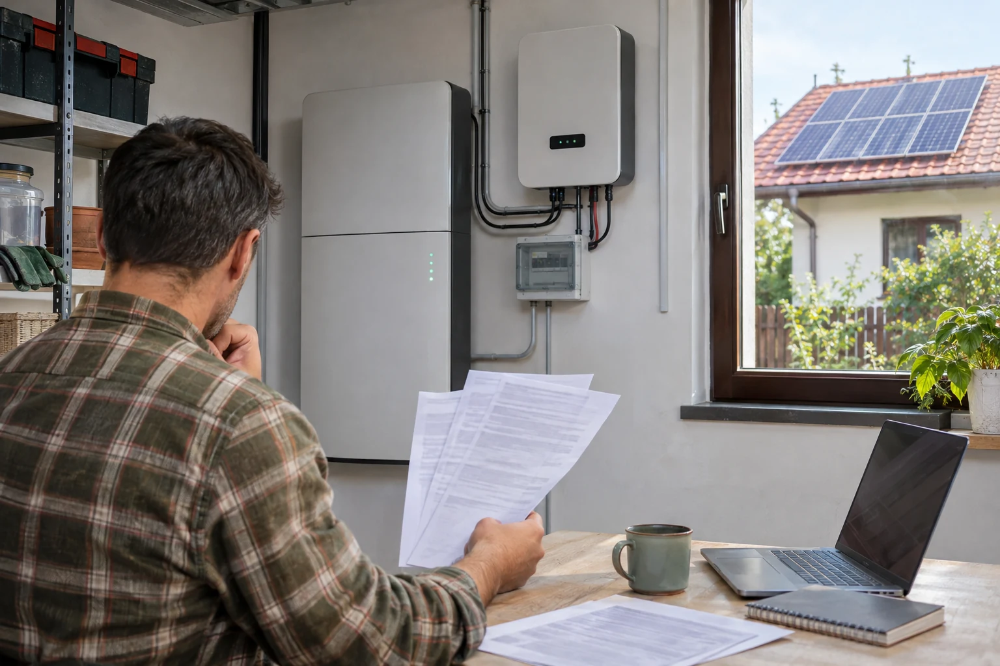

# Baterii pentru prosumatori: cum se aplică finanțarea AFM de 400 milioane de lei în Dâmbovița

Pentru prosumatorii din Dâmbovița, regulile comunicate la 18 noiembrie stabilesc modul în care va fi aleasă oferta. Administrația Fondului pentru Mediu a publicat clarificări despre programul destinat bateriilor pentru prosumatori. Bugetul anunțat este de 400 de milioane de lei.

Înscrierea se face direct de către solicitant, nu printr-un instalator ales înainte. Din momentul aprobării, există un termen de 90 de zile pentru alegerea unei firme din lista validată.

## Plafoanele nu sunt prețuri impuse

AFM tratează valorile de 15.000 de lei pe sistem și 1.500 de lei/kWh drept limite superioare ale finanțării, nu drept prețuri obligatorii.

Instituția avertizează că ofertele nu trebuie majorate artificial până la plafon. Prosumatorii sunt sfătuiți să ceară costuri defalcate și să compare echipamentul, montajul și garanția.

Sesizările privind înțelegeri anticoncurențiale ori prezentări comerciale înșelătoare pot fi analizate de instituțiile de concurență și de protecție a consumatorilor. Informațiile sunt prezentate aici într-o versiune editorială proprie pentru publicația edambovita.

## Surse

- https://www.afm.ro/media_comunicate_presa-2026_11_18.php
