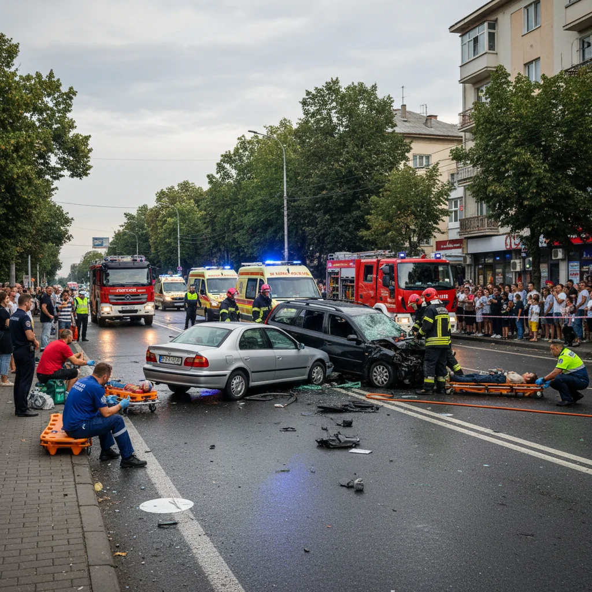

# Dâmbovița: cinci persoane, între care doi minori, rănite într-un accident pe DN 71 la Bungetu

Poliția Dâmbovița a anunțat că accidentul s-a produs în jurul orei 17:40, pe DN 71. În coliziune au fost implicate o mașină condusă de un bărbat de 73 de ani și un autoturism condus de o femeie de 44 de ani.

## Ce s-a întâmplat

Femeia și cei patru pasageri ai săi, inclusiv cei doi minori, au fost răniți și transportați la spital. Testele efectuate șoferilor nu au indicat consum de alcool.

## Informațiile autorităților

Cinci persoane au fost transportate la spital după coliziunea dintre două autoturisme produsă la 8 noiembrie, în afara localității Bungetu. Printre răniți se află doi minori.

## Ce urmează

Polițiștii continuă cercetările pentru a stabili cauzele și împrejurările producerii accidentului.

## Surse

- https://db.politiaromana.ro/ro/stiri-si-media/stiri/accident-rutier-in-afara-localitatii-bungetu1794312538

