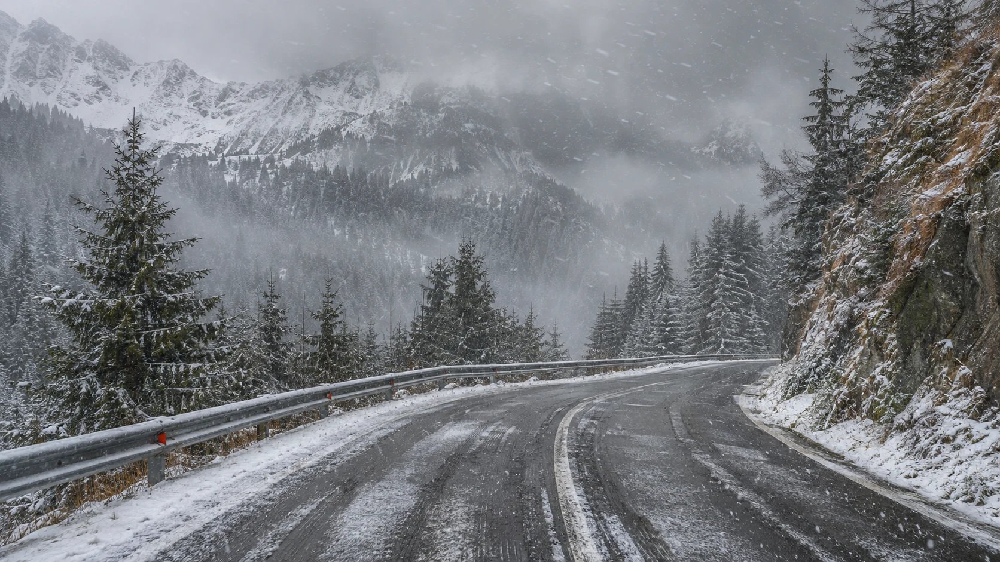

# Cod galben de viscol în munții Dâmboviței pe 26 noiembrie

Administrația Națională de Meteorologie a inclus zona montană din județul Dâmbovița în atenționarea cod galben valabilă joi, 26 noiembrie 2026, între orele 05:00 și 20:00.

## Ce intensitate vor avea fenomenele

În sectorul montan, vântul va avea 60–70 km/h, iar în zona înaltă rafalele vor ajunge la 90–110 km/h. Ninsoarea va fi viscolită, vizibilitatea va scădea, iar la altitudini de peste 1.400 m se va depune un strat de 10–15 cm. În vestul Carpaților Meridionali, stratul poate ajunge local la aproximativ 25 cm.

Harta oficială nu extinde codul galben asupra întregii țări. Pentru Dâmbovița, atenționarea trebuie citită în raport cu zona colorată și cu relieful montan; mesajul poate fi actualizat dacă evoluția vremii o impune.

## Surse

- https://www.meteoromania.ro/avertizari/
