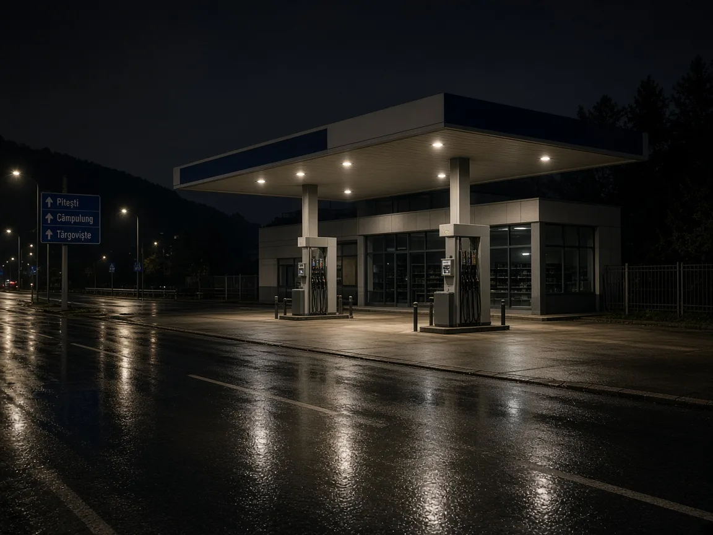

# Dosar penal la Băleni: șofer fără permis, depistat pe DJ 711 sub influența alcoolului

Testarea a indicat 0,73 mg/l alcool pur în aerul expirat. Poliția afirmă că bărbatul nu deține permis pentru nicio categorie; el a fost dus la spital pentru recoltarea mostrelor biologice.

Reținerea a fost dispusă la 9 noiembrie, iar cercetările continuă sub coordonarea Parchetului de pe lângă Judecătoria Târgoviște. Persoana cercetată beneficiază de prezumția de nevinovăție.

Un bărbat de 32 de ani din Băleni a fost reținut pentru 24 de ore într-un dosar privind conducerea fără permis și sub influența alcoolului. Potrivit IPJ Dâmbovița, acesta ar fi fost oprit pe DJ 711, în comuna Băleni, pe 6 noiembrie, în jurul orei 04:30.

## Surse

- https://db.politiaromana.ro/ro/stiri-si-media/stiri/barbat-retinut-pentru-comiterea-infractiunii-de-conducerea-unui-vehicul-fara-permis-de-conducere-si-conducerea-unui-vehicul-sub-influenta-alcoolului
