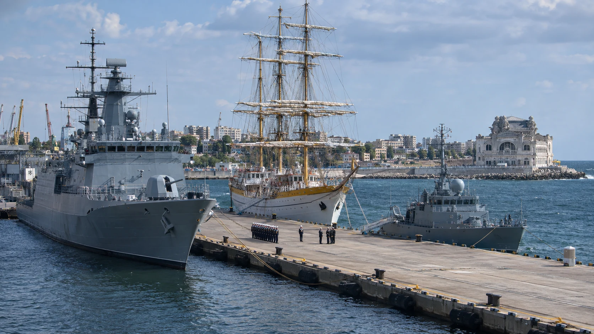

# Perimetru de siguranță de 800 de metri după incidentul GPL de la Cornești

Potrivit instituției, circulația pe DN1A a fost oprită la kilometrul 44, pe aproximativ un kilometru. Spre București, mașinile ușoare au fost deviate pe DC34A, iar vehiculele grele pe DJ711E; spre Ploiești, devierea s-a făcut pe DJ101G.

## Datele comunicate de instituție

Separat, comunicatul precizează că pompierii și polițiștii au evacuat persoanele dintr-un perimetru de 800 de metri. Comunicatul descria intervenția ca fiind în desfășurare și nu indica existența unor victime.

Din punct de vedere practic, poliția a fost sesizată la 11 noiembrie, în jurul orei 16:15, despre scurgeri de gaze la o stație GPL din Cornești.

## Surse

- https://db.politiaromana.ro/ro/stiri-si-media/comunicate/comunicat-de-presa1794552153
