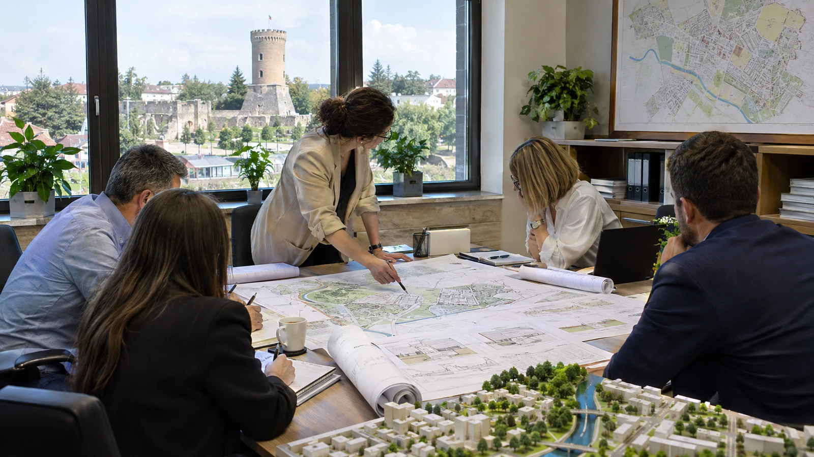

# CTATU Târgoviște — 14 documentații analizate în ședința din 6 noiembrie

Conform comunicării instituției, cinci solicitări au fost amânate, inclusiv depozitul Crucii Roșii. Au primit avize, unele condiționate de completări, proiecte pentru hale, locuințe, un bloc, o clădire de alimentație publică, o parcare supraetajată și alte investiții.

Conform comunicării instituției, un aviz de oportunitate sau al arhitectului-șef este o etapă administrativă și nu echivalează, singur, cu autorizația de construire. Detaliile fiecărui amplasament sunt în documentul oficial.

Conform comunicării instituției, comisia Tehnică de Amenajare a Teritoriului și Urbanism Târgoviște a analizat 14 documentații în ședința online din 6 noiembrie, potrivit centralizatorului publicat de Direcția Urbanism.

## Surse

- https://www.pmtgv.ro/UrbPMT/2026/20261124_Centralizator_noiembrie.pdf
