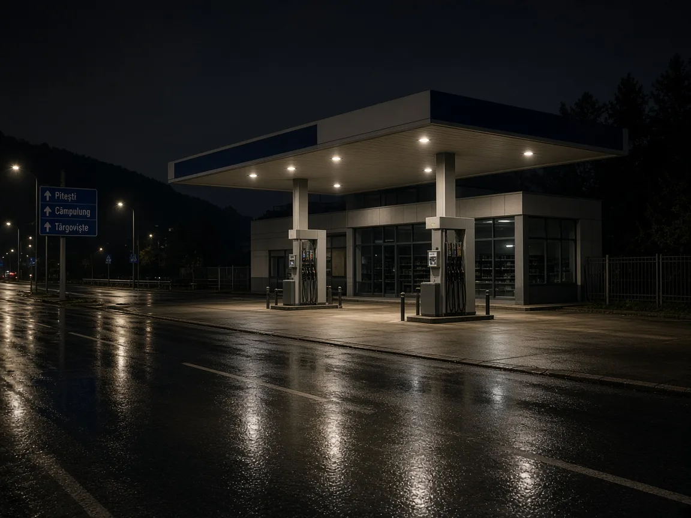

# Dâmbovița: peste 5 kg canabis din Spania, doi arestați 30 de zile

Un dosar de trafic internațional și intern de droguri de risc, instrumentat de DIICOT în județul Dâmbovița, s-a încheiat azi cu arest preventiv pentru doi inculpați. Ei ar fi adus canabis din Spania prin curierat și l-ar fi preluat la Târgoviște în colete de peste 2 kg și, respectiv, peste 3 kg.

## Cum descrie DIICOT lanțul

Comunicatul de presă al DIICOT – Biroul Teritorial Dâmbovița arată că drogurile ar fi fost procurate din Spania și introduse în România prin firme de curierat internațional. Pe 3 noiembrie 2026, anchetatorii și polițiștii SCCO Dâmbovița au organizat două acțiuni în flagrant delict în Târgoviște, imediat după ce suspecții ar fi ridicat coletele.

Inculpații au vârste de 28 și 48 de ani. Ei sunt cercetați pentru trafic internațional și intern de droguri de risc, infracțiune pentru care procurorii au dispus reținerea în 4 noiembrie 2026.

## Decizia de azi de la Tribunalul Dâmbovița

La 5 noiembrie 2026, judecătorii de drepturi și libertăți de la Tribunalul Dâmbovița au admis arestarea preventivă a celor doi, câte 30 de zile fiecare. Măsura a fost luată după sesizarea procurorilor DIICOT.

Comunicatul nu menționează alte persoane cercetate în același dosar și nici eventuale percheziții conexe. Cercetările continuă în cadrul procedurilor penale.

## Prezumția de nevinovăție

DIICOT reamintește că persoanele cercetate beneficiază de prezumția de nevinovăție și de toate garanțiile procesuale prevăzute de lege. Reținerea și arestarea preventivă sunt măsuri procesuale temporare; răspunderea penală se stabilește doar printr-o hotărâre judecătorească definitivă.

## Surse

- https://www.diicot.ro/mass-media/6770-comunicat-de-presa-4-05-11-2026
