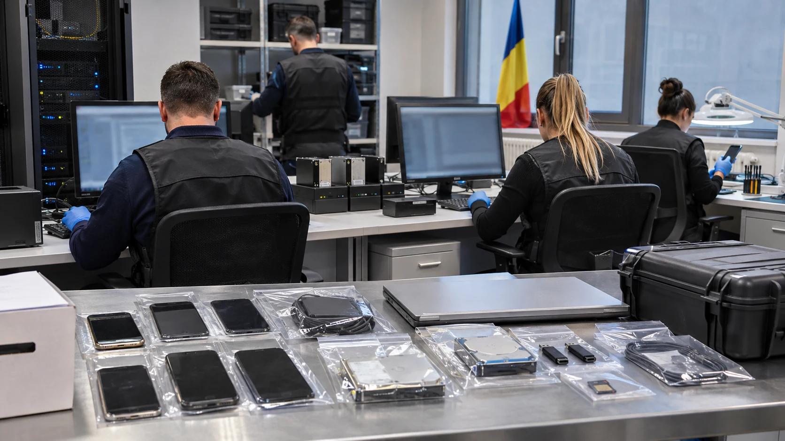

# Dâmbovița: 21 de percheziții într-un dosar de acces ilegal la sisteme informatice

Pentru cititorii din Dâmbovița, informația verificată privește direct 21 de percheziții într-un dosar de acces ilegal la sisteme informatice.

Patru persoane s-au înregistrat reținute, iar anchetatorii au ridicat telefoane, calculatoare și alte dispozitive care urmează să fie analizate criminalistic.

Polițiștii au executat, la 12 noiembrie, 21 de mandate de percheziție într-un dosar privind acces ilegal la sisteme informatice. Acțiunile au avut loc în Dolj, Bihor, Argeș, Dâmbovița, Vaslui și Ilfov.

Ancheta continuă sub coordonarea procurorului. Măsurile preventive și ridicarea echipamentelor nu înlătură prezumția de nevinovăție a persoanelor vizate.

## Surse

- https://db.politiaromana.ro/ro/stiri-si-media/stiri/update-21-de-mandate-de-perchezitie-domiciliara-pentru-comiterea-de-infractiuni-de-acces-ilegal-la-un-sistem-informatic1795088203
