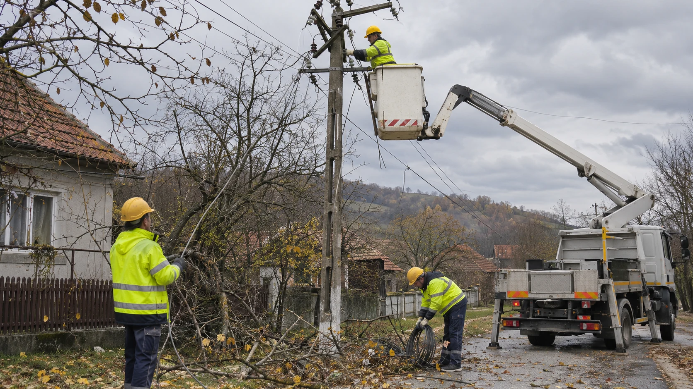

# Dâmbovița: avarii în rețeaua electrică după fenomenele meteo severe din Dâmbovița

Actualizarea publicată de instituția competentă privește direct județul Dâmbovița.

În Dâmbovița erau afectați 1.841 de utilizatori din Fierbinți, Mija, Ghiordoveni și zona montană a județului.

În întreaga arie afectată, operatorul a raportat 127 de localități, 582 de posturi de transformare sau alimentare nealimentate și 36.037 de utilizatori fără curent la momentul bilanțului.

Echipele operative au fost mobilizate pentru localizarea, izolarea și remedierea defectelor. Operatorul recomandă verificarea hărții întreruperilor și folosirea canalelor oficiale pentru sesizarea deranjamentelor.

Fenomenele meteo severe au afectat alimentarea cu energie electrică în județul Dâmbovița, potrivit situației publicate de Distribuție Energie Electrică Romania la 20 noiembrie, ora 08:00. Noile date operative pot fi verificate în comunicările oficiale ale instituției.

## Surse

- https://www.distributie-energie.ro/comunicat-conditii-meteo-nefavorabile-20-11-2026-ora-0800
