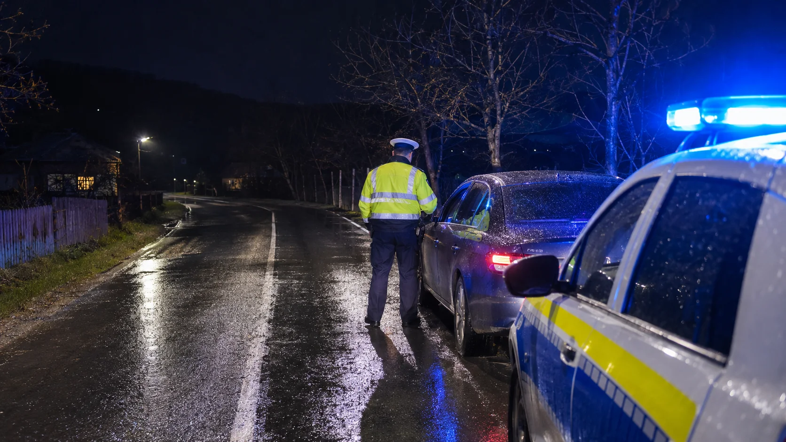

# Dosar penal după un control nocturn pe DJ 712A, în comuna Vârfuri

În 17 noiembrie, în jurul orei 23:50, polițiștii au oprit pe DJ 712A, în comuna Vârfuri, un autoturism condus de un bărbat de 39 de ani din Târgoviște.

Polițiștii au deschis dosar penal. Stabilirea răspunderii se face în cadrul cercetărilor și, dacă va fi cazul, de instanță.

Aparatul etilotest a indicat 0,84 mg/l alcool pur în aerul expirat. Șoferul a fost condus la o unitate medicală pentru recoltarea probelor biologice.

## Surse

- [https://db.politiaromana.ro/ro/stiri-si-media/stiri/barbat-surprins-la-volan-sub-influenta-alcoolului1795094551](https://db.politiaromana.ro/ro/stiri-si-media/stiri/barbat-surprins-la-volan-sub-influenta-alcoolului1795094551)
