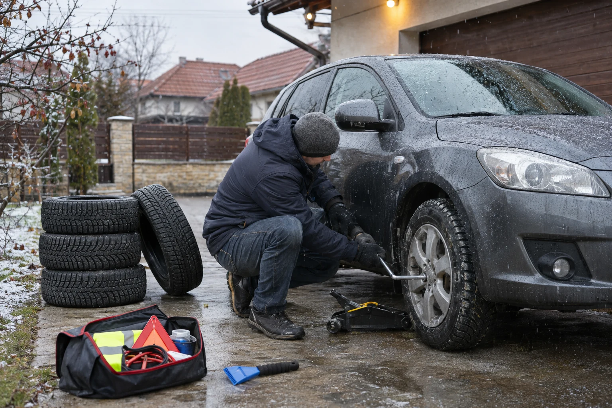

# Târgoviște: ce trebuie verificat la mașină înainte de prima ninsoare. Detaliile publicate de instituție

Conducătorii auto din Târgoviște pot folosi lista publicată de IGSU pentru a pregăti vehiculele înainte de zăpadă și polei.

Viteza trebuie redusă la starea carosabilului, iar distanța față de vehiculul din față mărită.

Pompierii recomandă montarea anvelopelor de iarnă înaintea apariției zăpezii și a poleiului.

Verificările indicate privesc bateria, frânele, luminile și lichidul de parbriz potrivit temperaturilor scăzute.

## Ce urmează

În mașină ar trebui păstrate o lopată, o racletă, o lanternă și o pătură pentru situațiile în care deplasarea este întreruptă.

## Surse

- https://isudb.igsu.ro/comunicate-de-presa/nu-astepta-prima-ninsoare!-preventia-nu-tine-de-vreme.-tine-de-tine.-1422
