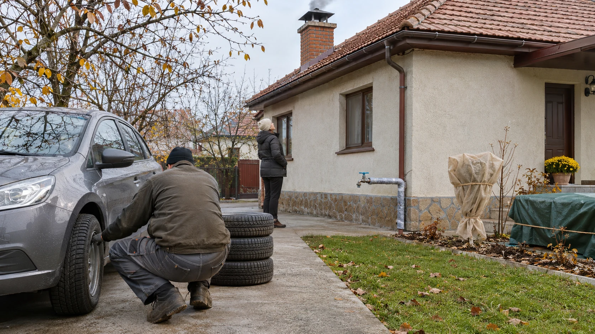

# Dâmbovița: recomandările pompierilor pentru pregătirea înainte de prima ninsoare — datele oficiale

Pentru locuințe sunt recomandate verificarea instalațiilor de încălzire, a coșurilor de fum și a instalației electrice, curățarea acoperișului și jgheaburilor, fixarea obiectelor care pot fi luate de vânt și protejarea conductelor expuse la îngheț. Inspectoratul pentru Situații de Urgență a reluat în județul Dâmbovița campania „Nu aștepta prima ninsoare!”. Mesajul pune accent pe măsurile care pot fi luate înainte ca frigul și precipitațiile să provoace probleme.

Șoferii sunt sfătuiți să controleze starea mașinii și echiparea pentru iarnă, să consulte condițiile meteo și de drum înainte de plecare și să păstreze în autoturism o lanternă, baterii și un kit de urgență. Telefonul trebuie încărcat, iar persoanele vulnerabile din apropiere pot avea nevoie de sprijin. Informația privește direct comunitățile din Dâmbovița.

## Surse

- https://isudb.igsu.ro/comunicate-de-presa/nu-astepta-prima-ninsoare!-preventia-nu-tine-de-vreme.-tine-de-tine.-1422
