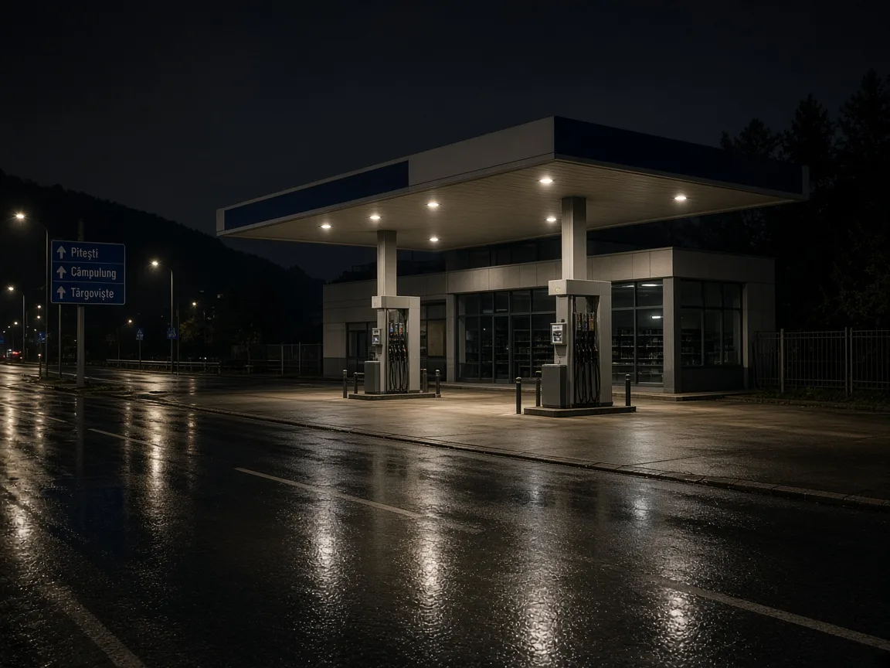

# Șofer de 32 de ani cercetat după ce ar fi condus fără permis pe DJ 711

Polițiștii din Dâmbovița cercetează un bărbat de 32 de ani, oprit pe DJ 711 în dimineața zilei de 6 noiembrie. Acesta nu ar deține permis de conducere.

## Măsura luată de anchetatori

Testarea alcoolscopică a indicat 0,73 mg/l alcool pur în aerul expirat. Oprirea în trafic a avut loc la 6 noiembrie, în jurul orei 04:30. Dosarul privește conducerea fără permis și conducerea sub influența alcoolului.

## Datele controlului rutier

Bărbatul a ajuns să fie reținut pentru 24 de ore și prezentat magistraților la 10 noiembrie. Cercetarea este în desfășurare, cu respectarea prezumției de nevinovăție.

## Surse

- https://db.politiaromana.ro/ro/stiri-si-media/stiri/barbat-retinut-pentru-comiterea-infractiunii-de-conducerea-unui-vehicul-fara-permis-de-conducere-si-conducerea-unui-vehicul-sub-influenta-alcoolului

