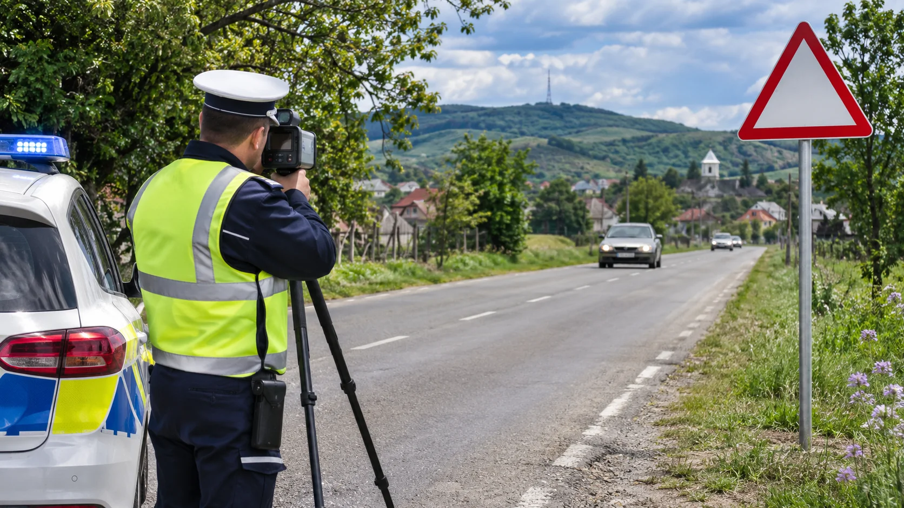

# Șoferii sunt avertizați asupra controalelor radar pe sectoarele cu risc din Dâmbovița

Consiliul Județean Dâmbovița a montat indicatoare de informare privind controlul radar pe sectoare de drum unde sunt constatate repetat depășiri ale vitezei.

## Ce arată informarea oficială

Potrivit datelor oficiale, măsura este una preventivă și nu înlocuiește controalele efective desfășurate de echipajele rutiere. Indicatoarele au fost instalate de Consiliul Județean la solicitarea poliției.

Potrivit datelor oficiale, iPJ Dâmbovița reamintește că viteza excesivă sau neadaptată condițiilor de drum este unul dintre factorii care favorizează accidentele și anunță continuarea monitorizării.

Potrivit datelor oficiale, sectoarele au fost identificate de Inspectoratul de Poliție Județean Dâmbovița ca zone cu risc rutier ridicat și cu încălcări repetate ale regimului legal de viteză.

## Surse

- [https://db.politiaromana.ro/ro/stiri-si-media/comunicate/comunicat-de-presa1794310268](https://db.politiaromana.ro/ro/stiri-si-media/comunicate/comunicat-de-presa1794310268)
