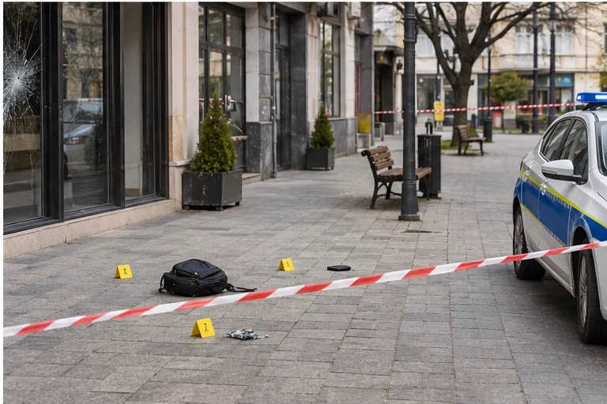

# Bărbat cercetat pentru tâlhărie și lovire în Dâmbovița — datele oficiale

Pentru publicul din Dâmbovița, datele oficiale relevante sunt următoarele. Măsurile procesuale nu reprezintă o hotărâre de vinovăție. Probe și declarații sunt administrate sub coordonarea parchetului competent.

Cercetările vizează posibile fapte de tâlhărie și lovire sau alte violențe, după o sesizare analizată de polițiștii dâmbovițeni.

Persoana cercetată beneficiază de prezumția de nevinovăție până la o hotărâre judecătorească definitivă.

## Surse

- https://db.politiaromana.ro/ro/stiri-si-media/stiri/cercetat-de-politisti-sub-aspectul-savarsirii-infractiunilor-de-talharie-si-lovire-sau-alte-violente
