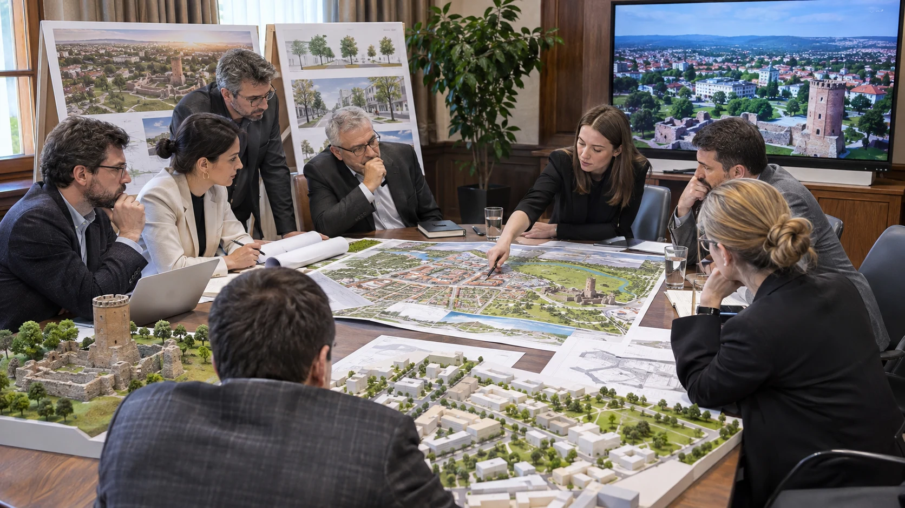

# Ce proiecte urbanistice au primit aviz la ședința tehnică din Târgoviște

Avizul de oportunitate nu este autorizație de construire; mai multe documente urmează să fie eliberate numai după completările cerute de comisie. Informațiile provin din comunicarea publicată de Primăria Municipiului Târgoviște.

## Informațiile esențiale

Centralizatorul privește analiza tehnică din 6 noiembrie și a fost publicat de Direcția Urbanism. Fiecare investiție rămâne supusă celorlalte avize și proceduri legale înainte de autorizarea lucrărilor.

Au primit numere de aviz proiectul unor hale de depozitare pe strada Petru Cercel, două locuințe pe Aleea Coconilor, un bloc pe strada Stolnicul Constantin Cantacuzino și o hală metalică pe strada Ilfovului. Proiectele privind schimbarea destinației unei locuințe, lotizarea unui teren, un imobil colectiv cu servicii și amplasarea unui container comercial au fost amânate.

## Ce urmează

Precizările de mai sus redau statutul comunicat de Primăria Municipiului Târgoviște; acolo unde există o anchetă sau un vot, rezultatul nu este anticipat.

## Surse

- https://www.pmtgv.ro/UrbPMT/2026/20261124_Centralizator_noiembrie.pdf
