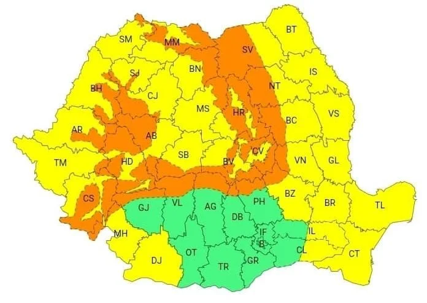

# Vânt de până la 140 km/h pe creste și ploi abundente în Dâmbovița, în două avertizări succesive

Locuitorii județului Dâmbovița și cei care au drum spre munte trebuie să urmărească două avertizări meteorologice care se succed de vineri până sâmbătă dimineața. Prima privește vântul foarte puternic la altitudine, iar a doua anunță cantități mari de ploaie.

Codul portocaliu este în vigoare vineri, 13 noiembrie, de la ora 10:00 până la 21:00. În zona montană sunt estimate viteze ale vântului de 90–120 km/h, iar la altitudini mari intervalul indicat de meteorologi urcă la 120–140 km/h.

## Averse în noaptea de vineri spre sâmbătă

De la ora 01:00, pe 14 noiembrie, județul intră sub cod galben de ploi însemnate cantitativ. Avertizarea rămâne valabilă până la ora 11:00. ISU Dâmbovița transmite că aversele pot aduce 20–35 l/mp, fie într-un interval scurt, fie prin acumulare.

Intensitatea maximă a vântului este prognozată pentru creste, nu pentru toate localitățile județului. În schimb, atenționarea de ploi este formulată pentru Dâmbovița la nivel județean. Intervalele exacte sunt importante pentru deplasările programate vineri seara și sâmbătă dimineața.

## Surse

- https://isudb.igsu.ro/comunicate-de-presa/avertizare-si-atentionare-meteorologice-1417
